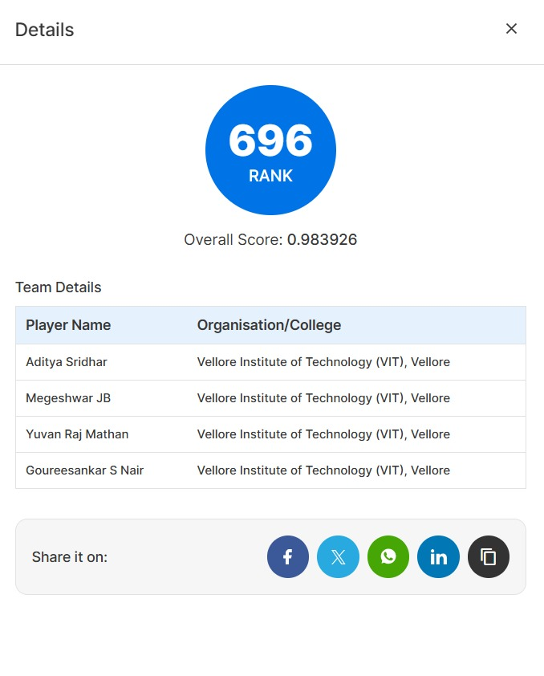
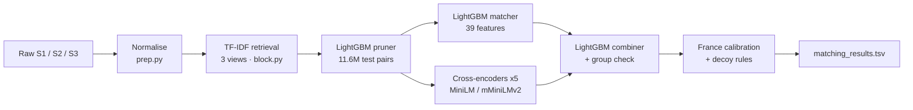

# Business Entity Resolution · Amazon ML Challenge 2026

<p align="center">
  
</p>

<p align="center">
  <b>Public leaderboard rank 696</b> · overall score <b>0.983926</b> (macro F0.5)<br>
  Team <b>GiTWrech</b> · Vellore Institute of Technology (VIT), Vellore
</p>

---

## The problem

Business records arrive from three independent sources with no shared identifiers. Names carry abbreviations,
legal-suffix changes, typos and native-script transliterations; addresses are partial, reordered or written
relative to landmarks. Source 1 is the deduplicated reference: for every Source 1 entity, find all Source 2 and
Source 3 records that describe the same real-world business.

- **Scale:** 2.2M S1 and 10.3M S2+S3 records in train; 1.73M S1 and 10M S2+S3 in test.
- **Countries:** train covers US and India. Test adds **France (259k S1 entities) with no training data at all.**
- **Hard negatives:** decoys that copy an S1 record and change only the legal form, the house number or one word.
- **Metric:** macro F0.5 per S1 entity, so precision counts more than recall.

The full challenge statement is in [`docs/challenge/README.md`](docs/challenge/README.md).

## Approach



1. **Normalisation** (`prep.py`): a native-script to English word map *learned from the training matches*
   (no external dictionary), `unidecode`, per-country abbreviation and state-code maps, and French legal forms
   kept as tokens so decoys stay visible.
2. **Candidate generation** (`block.py`): per-country sparse TF-IDF top-k over a word view, a character 3-gram
   name view, and a hashed name-word × address-word view. Union recall **0.980** on train. A small LightGBM
   pruner on retrieval scores cuts test candidates from 125M to 11.6M pairs at a cost of 0.0005 F0.5.
3. **Matcher** (`features.py`, `train.py`): LightGBM over rapidfuzz name/address similarities, house-number and
   PIN agreement, and candidate-structure features (rank among a record's candidates, score gaps, counts).
4. **Cross-encoders** (`xenc.py`): five fine-tuned runs of `ms-marco-MiniLM-L12-v2` and the multilingual
   `mmarco-mMiniLMv2-L12-H384-v1`, trained on GPU in Kaggle notebooks, combined with the matcher by a second
   LightGBM model.
5. **Group check and decoy signatures** (`group.py`): does a candidate resemble the other records already
   matched to the same S1? Plus features for the decoy generator's fingerprints: house-number shifts, legal-form
   changes, the edit type between differing words, and word swaps.
6. **France without labels** (`group.py`, `variants.py`, `final.py`): a threshold calibrated so France gets the
   same matches per S1 as US/India, decoy rules for word swaps and street changes, and filler-word handling,
   each addition verified on the leaderboard one at a time.

Every S2/S3 record is assigned to at most one S1 entity, and thresholds are tuned directly for macro F0.5.

## Results

| Stage (held-out train S1 entities) | Macro F0.5 |
|---|---|
| LightGBM matcher | 0.9738 |
| Cross-encoder alone | 0.9757 |
| Matcher + cross-encoder combiner | 0.9828 |
| + group check | 0.9838 |
| + decoy-signature features | 0.9846 |
| **5-encoder ensemble + all of the above (US/India)** | **0.9855** |

On the public leaderboard, France was the main source of error. The first upload with a single shared
threshold scored 0.9666; calibrating France, keeping French legal forms, and the France decoy rules raised it
step by step to **0.983926 (rank 696)**.

**Lessons learned**

- For an unseen country, checking the *structure* of the predictions (France got 3.66 matches per S1 against
  3.35 for US/India) found more error than extra model capacity did. It exposed a normalisation step that was
  deleting exactly the signal (legal forms) that separates decoys from true matches.
- Filler words look like decoys to a US/India-trained model. Telling them apart without labels worked by
  comparing how often a word appears in S2/S3 names versus S1 names.
- Each leaderboard probe should change one thing, otherwise a gain and a loss can cancel out unseen.

The full write-up is in [`package/Documentation_template.md`](package/Documentation_template.md).

## Repository layout

```
src/                  pipeline code (prep, block, features, train, predict, xenc, group, variants, final)
kaggle/k_*/           Kaggle kernel definitions (one notebook per pipeline step)
kaggle/*.sh           helpers to push kernels, wait for them, and fetch their outputs
package/              reproduction guide, requirements, solution write-up, submission zip builder
native_map_learned.tsv  learned native-script -> English word map
docs/challenge/       original challenge statement and documentation template
assets/               leaderboard screenshot
```

## Reproducing

Step-by-step commands are in [`package/README.md`](package/README.md). In short:

```bash
pip install -r package/requirements.txt
# place the challenge data at dataset/train/*.tsv and dataset/test/*.tsv
python src/prep.py train test
python src/block.py train 10 && python src/features.py train 5 && python src/train.py 5 4
python src/block.py test 10 && python src/features.py test 10 && python src/predict.py
# then the cross-encoder runs (GPU), group.py and final.py, see package/README.md
```

Stage 1 needs about 8 GB RAM and around 5 hours on 4 CPU cores; each cross-encoder run takes about 3 hours on
one Kaggle GPU. The challenge dataset is not included in this repository.

## Team

| Name | Organisation |
|---|---|
| Aditya Sridhar | VIT Vellore |
| Megeshwar JB | VIT Vellore |
| Yuvan Raj Mathan | VIT Vellore |
| Goureesankar S Nair | VIT Vellore |

Models used: LightGBM (MIT), `cross-encoder/ms-marco-MiniLM-L12-v2` and
`cross-encoder/mmarco-mMiniLMv2-L12-H384-v1` (Apache 2.0). No external data or APIs.
